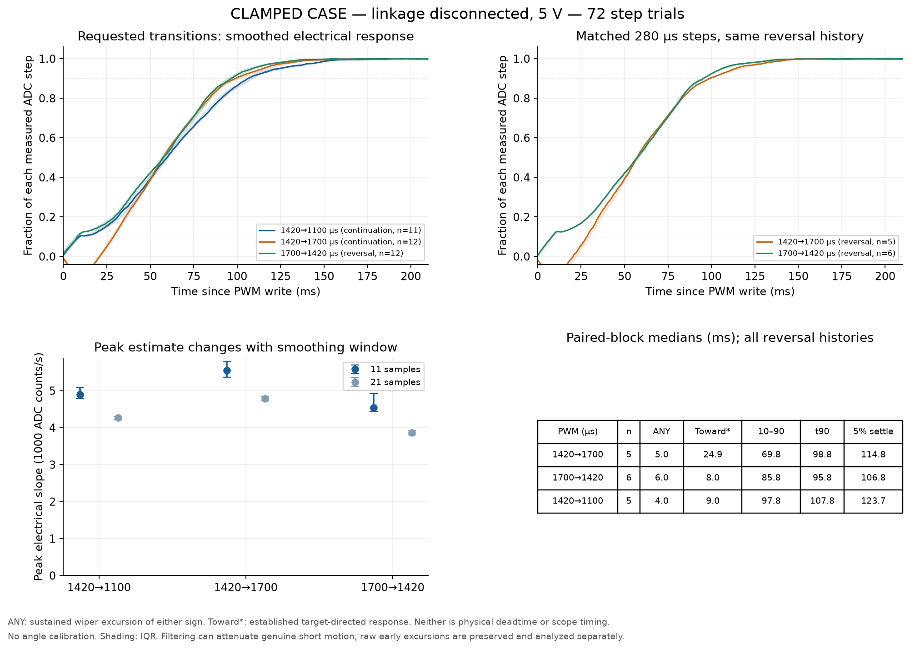
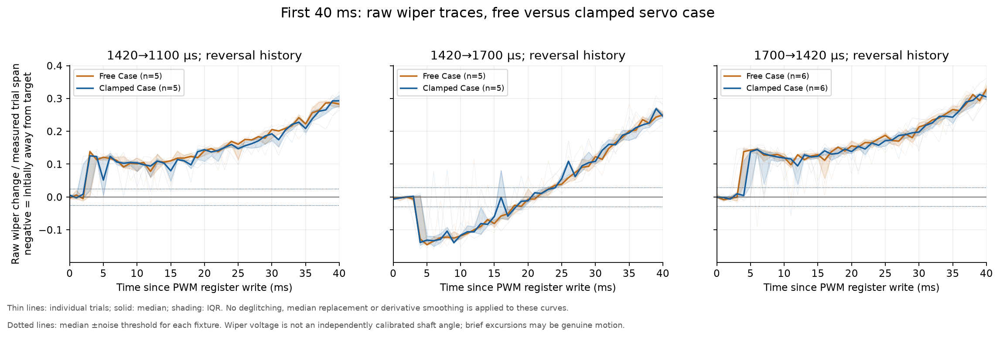
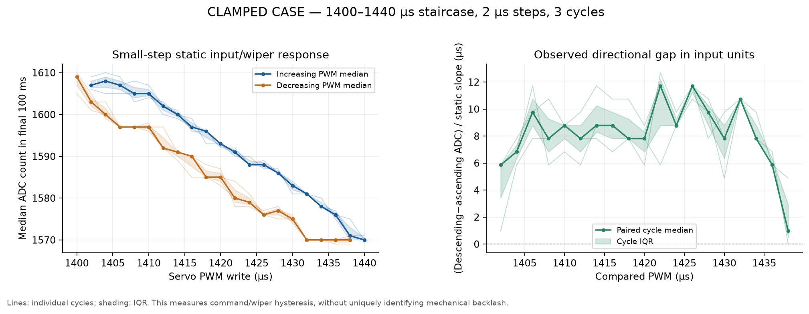

# Unloaded servo and wiper characterization — 2026-11-06

The repeat tests provide a useful **command-to-wiper-voltage baseline**, but the early signal is not yet a trustworthy measurement of physical shaft motion. Every one of the 72 clamped-case large-step trials initially produces a **positive ADC excursion**, regardless of the requested direction. The approximately 45–50-count kick is about **36–40 mV** at 3.28 V Vref. It survives clamping the case. Servo power/return/reference movement is therefore a credible explanation; mechanical motion and electrical effects have not been separated.

This matters for interpreting the apparent delay: on 1420→1700 µs the signal first moves **away** from the target at about 5 ms, then establishes movement toward it around 25 ms. The earlier 24–25 ms number was **target-directed onset, not first motion**. The user could not resolve the short clamped-arm movement visually. Do not turn that number into an actuator transport-delay constant.

## Conditions and preserved evidence

- EMAX ES08MD II, user-reported 5 V supply; output arm free and linkage disconnected. No aerodynamic or motor/rotor load was attached.
- Aircraft supply set to 7 V with a 2 A limit; reported voltage stayed above 6.82 V during the repeated servo tests. This slow measurement does not exclude a fast local servo-rail/ground transient.
- Firmware `bd6a5d727`, MATEKF405TE, 498 Hz configured servo output, PB0/ADC1_IN8 as `ADC_EXTERNAL1`, Blackbox approximately 1002 Hz. Motors were stopped throughout these recordings.
- First fixture: case unsecured. After the user observed reaction movement, the case was securely clamped and all tests repeated. Keep those conditions separate.
- Each fixture has 48 cyclic steps, 24 paired steps, and a three-cycle small-step staircase. Each full-size plateau lasts approximately 1.2 s. All original servo settings were restored after each block.

[Validation package](validation/tricopter-servo-2026-11-06/README.md) contains six immutable raw recordings, hashes, capture metadata, analysis code, declared methods/amendments, synthetic checks, per-trial values and plots. Every recording was downloaded twice with identical hashes. The clamped large-step records contain 63223 and 33158 frames, with clean ends and no final-PWM/native-servo mismatch. Raw data were not changed for filtering or fixture corrections.

## Requested transitions

These are **clamped-case, matched reversal-history medians**, using 5, 5 and 6 repeats respectively. Additional cyclic trials and their distributions are retained separately in [the block summary](validation/tricopter-servo-2026-11-06/response/clamped-case/per-block-summary.csv). The 1420→1100 request is 320 µs; the other two requests are 280 µs, so they are not all equal-amplitude moves.

| Observed wiper metric | 1420→1100 | 1420→1700 | 1700→1420 |
|---|---:|---:|---:|
| First detectable excursion, either direction | 4.0 ms, toward | 5.0 ms, **away** | 6.0 ms, toward |
| Established target-directed onset | 9.0 ms | 24.9 ms | 8.0 ms |
| 10–90% movement time | 97.8 ms | 69.8 ms | 85.8 ms |
| Command write to 90% | 107.8 ms | 98.8 ms | 95.8 ms |
| Peak target-directed slope, 11-sample fit | 4938 counts/s | 5412 counts/s | 5407 counts/s |
| Same peak / measured 1100–1700 full span | 7.43 spans/s | 8.14 spans/s | 8.14 spans/s |
| Filtered sustained positive overshoot | 0.54% | 0.32% | 0.68% |
| Filtered settling within 5% of this step | 123.7 ms | 114.8 ms | 106.8 ms |
| Filtered settling within 2% of this step | 142.7 ms | 132.7 ms | 124.2 ms |

The measured full electrical span is approximately **664.5 ADC counts**. There is no degree calibration, so counts/s and normalized spans/s are supplied instead of invented degrees/s.

The 5% settling result is more defensible than the 2% result. In **71 of 72 clamped trials**, the 2% band is narrower than three raw-noise standard deviations. Likewise, **no filtered sustained overshoot is resolved above the declared noise criterion**; the small percentages in the table should not be read as demonstrated mechanical overshoot. Raw single-sample peaks are retained separately and can be much larger.

Peak slope is explicitly bandwidth-dependent. Moving from an 11-sample to a 21-sample fit reduces individual estimates by roughly 7–42% across the measurements. The table is a defined, smoothed target-directed wiper-slew estimate, not a proven instantaneous maximum shaft speed. Possible very early peaks and wrong-way motion are recorded separately.



The useful descriptive comparison is that 1420→1700 has a later established target-directed response and a shorter measured 10–90% interval than its return, while both reach 90% around 96–99 ms. **The common positive voltage kick can bias both of those onset/rise measurements.** This is not sufficient evidence for an intrinsically slower mechanical direction or a validated asymmetric actuator model.

## First excursion and fixture comparison

The analysis now distinguishes three events: first sustained excursion in either direction, first sustained excursion toward the target, and established target-directed response that continues into the main step. The original `onset_ms` field remains an alias of the last event for auditability; its meaning is explicit in the results.

First-excursion detection uses raw samples and a per-trial threshold of `max(3 × robust baseline sigma, 2% of measured step span, 3 counts)`, sustained for five samples. It is a **thresholded electrical observation**, not the earliest infinitesimal physical movement. Brief reverse excursions are retained, not declared electrical artifacts merely because they are brief.

The first 40 ms comparison below uses raw individual traces and their median/IQR, without impulse replacement or derivative smoothing. Clamping did not remove the feature. For matched 1420→1700 trials, the initial opposite-sign peak remains about 15% of the measured step; the above-threshold wrong-way run is about 9 ms.



## Power-wire/reference hypothesis

For a single-ended FC reading, a useful relation is:

```text
V_ADC = V_wiper_relative_to_servo_ground + V_servo_ground_relative_to_FC_ground
```

Ground-return rise can add a positive offset regardless of requested motion. This would help an ADC-increasing step appear to start early, and make an ADC-decreasing step initially appear to reverse. A change in the potentiometer's own excitation/reference voltage can also alter the wiper without equivalent shaft movement. A positive-supply drop alone would normally lower a fixed-ratio wiper voltage; the observed positive sign specifically warrants checking the return/reference path as well.

[The signed early-signal analysis](validation/tricopter-servo-2026-11-06/response/fixture-comparison/clamped-early-signed-adc.json) finds positive first sustained excursions in **72/72 clamped trials**. Median signed changes around 5–10 ms are approximately +35 to +41 counts across all four step directions. This supports the power/reference hypothesis, but it is not proof without independent voltage/position measurement.

A discriminating measurement is to scope the wiper and servo ground **both relative to FC ground**, then subtract the channels; also inspect the local servo supply and, ideally, the potentiometer excitation. An independent output-arm marker/video or angle sensor distinguishes voltage movement from shaft movement. Merely buffering the wiper relative to FC ground would not subtract a moving servo-ground reference. Do not use the early wiper transient as measured angle in an active controller until resolved.

Source inspection confirms PB1/TIM3 CH4 uses compare-register preload. Normal writes wait for a timer update rather than immediately changing an active compare value mid-pulse. At the configured rate, the frame is about 2.008 ms. Thus the logged write is not an independently measured pulse edge, and scope verification remains necessary.

## Small-step hysteresis and the gear-lash hypothesis

The additional staircase used 2 µs command increments between 1400 and 1440 µs, with approximately 0.27 s actual holds, repeated three times. The final 100 ms of each plateau provides a static median and noise estimate. Only common interior PWM values, approached from both directions, are paired.

For the clamped case, the median directional difference is approximately **7.8 µs input-equivalent**, with a maximum per-PWM median near 11.7 µs, using the fitted local slope of approximately −1.024 count/µs. The free-case estimate was about 9.9 µs. Three cycles, measurement order and overlapping variation do not establish a statistically proven reduction from clamping.



This is repeatable **command/wiper hysteresis**, not a measured mechanical gear-lash angle. Gear slack, internal deadband, friction, quantization and direction-dependent holding/reference effects remain possible contributors. Motor-side motion/current, output angle or a known torque would be needed to separate them. The power/reference question should be resolved before attributing this gap to mechanics.

## Method and use limits

Baseline and endpoint are measured independently for each trial, using a pre-step 200 ms median/MAD and final 300 ms median. Rise fractions use that trial's actual endpoint displacement. Derivative and filtered settling use documented short local-linear fits; both 11- and 21-sample estimates are retained. Settling must remain inside the specified band for the remainder of the hold, with at least 100 ms confirmation. None of the large-step trials required right-censoring at the hold limit.

Independent review and synthetic tests caught and corrected two short-pulse contamination issues in the initial metric implementation. Methods/amendments and original outputs are preserved. All physical raw recordings remain unchanged. Both fixture datasets use the same final analysis code.

These results establish an unloaded electrical baseline and expose a measurement issue worth solving. They do not identify rotor angle, isolated transport delay, torque/load, or loaded tail behavior. After verifying the signal/reference and calibrating angle, repeatable flight data can show how response changes with rotor RPM, body motion and gyro loading; position alone still does not uniquely determine load torque.
