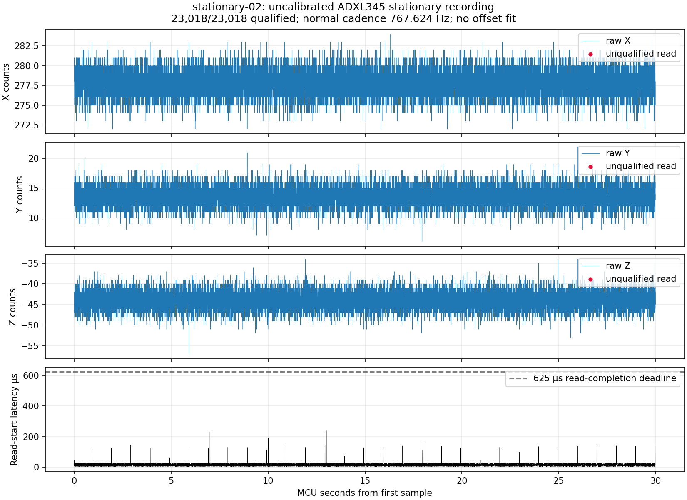

# Teensy LC / ADXL345 first hardware check — 2026-11-07

The requested logger was flashed to the connected **Teensy LC, USB serial 12696530**, and checked with the ADXL345 mounted on the motor basket. The user reports the sensor centre roughly at the pivot, +X up and +Y toward the drone's right side. The FC was not connected to the PC and was not accessed. No servo/motor command was generated and PB0−PC0 remains unchanged.

The initial source-verified firmware was uploaded successfully, then a 15-second stationary recording exposed a once-per-second acquisition disturbance. The synchronous periodic configuration audit read ten SPI registers without returning to sampling. Its timing flags correctly rejected 15 samples and reported one unread-data overrun. The [small source fix](capture/periodic-readback.patch) retains full startup verification and spreads periodic readback across foreground iterations, yielding to a pending sample. It changes no sensor configuration, wire format, offsets, PWM capture or actuator behavior.

After **18 host tests** and successful **LC / 3.6 / 4.0 builds**, the fixed firmware was uploaded to the same LC. Its deployed HEX SHA-256 is `a901ddc3336514cba128eefe5881d5e566f2ad276e334c27821a47d6b38e97c0`. Upload logs and the exact HEX/source hashes are retained in `capture/`. Programming succeeded and post-boot behavior was checked; an independent flash-memory readback was not performed. The source base is `92de378bd`, plus the included patch.

## Before/after acquisition result

| Metric | Initial recording | Fixed follow-up |
|---|---:|---:|
| Requested recording duration | 15 s | 30 s |
| Sample records | 11,493 | 23,018 |
| Qualified samples | 11,478 (99.8695%) | **23,018 (100%)** |
| Healthy status records | 15 | 30 |
| Sensor-overrun counter increment | 1 | **0** |
| Service-gap counter increment | 15 | **0** |
| Firmware queue-drop increment | 0 | 0 |
| CRC errors / missing logger sequences | 0 / 0 | 0 / 0 |
| Normal qualified cadence | 767.137 Hz | **767.624 Hz** |

All status records report `DEVID=0xE5`, `BW_RATE=0x0D`, `DATA_FORMAT=0x08`, fault `OK`. These establish communication with the expected register interface and the configured nominal 800 Hz/full-resolution ±2 g mode. **The observed cadence is about 768 Hz, not exactly 800 Hz.** The follow-up's qualified sample interval is 1302.7206 µs on average, with 0.5388 µs standard deviation and 1298–1307 µs range. Host arrival-span rate is 767.657 Hz, consistent with the MCU-derived cadence; host receive times are still not measurement timestamps.

Follow-up DRDY-to-read-start latency is 14 µs median, 24 µs at the 99th percentile and 239 µs maximum. All reads also pass the firmware's 625 µs read-completion guard. This is software timing evidence, not an independently measured DRDY pin-edge latency or sensor/filter delay. The periodic late-read pattern is absent after the fix. Small changes in mean acceleration between captures are not attributed to the firmware; physical pose and temperature were not independently controlled.

Each recording ends with one byte `A`, the start of the next frame magic when the timed recording stops. It is retained and reported as an incomplete tail, not decoded as a sample. The follow-up also has one 8 µs timestamp backstep from a status record to a sample whose DRDY occurred before that status was constructed (sequences 9994→9995). Sample timestamps remain increasing; there is no sequence/session reset. No PWM is fresh and its sequence remains zero, as expected without an FC signal.

## Stationary acceleration

Statistics below use all 23,018 follow-up samples; none required rejection. Nominal g scaling is raw counts divided by 256. It is **not calibrated sensitivity**.

| Axis | Mean raw counts | Population standard deviation, counts | Mean nominal g |
|---|---:|---:|---:|
| X | 277.7798 | 1.5479 | +1.08508 |
| Y | 13.6107 | 1.5537 | +0.05317 |
| Z | −43.9604 | 2.0775 | −0.17172 |

The mean-vector magnitude is **1.09987 nominal g**. Stable positive-X dominance is consistent with the reported up-facing X axis. The stationary data does not independently verify the right-facing Y direction or basket rotation sign. Unknown physical bias, scale factors and mounting tilt cannot be separated from a single pose. The means were **not** written back as offsets or treated as a zero-angle calibration. Hardware user-offset registers are deliberately zero; physical sensor bias remains unknown.

The data is sensible for beginning static calibration. Several orientations or a suitably constrained gravity-vector calibration are needed before interpreting it as accurate physical angle. Transient linear/centripetal acceleration, motor vibration, supply voltages and loaded/in-flight behavior remain unqualified. Mounting near the pivot reduces a geometric source of acceleration but does not eliminate those effects. See [logger wiring and measurement boundaries](../../../tools/tricopter/adxl345_logger/README.md).



## Preserved evidence and reproduction

`stationary-01/` and `stationary-02/` preserve original binary bytes, all CRC-valid sample/status CSV rows, acquisition metadata/hashes, descriptive statistics and plots. Baseline statistics use only configured, timestamp-qualified rows, with all-row statistics also retained. Event-counter increments use first/last snapshots rather than summing cumulative counters. Independent review re-decoded the binary with different chunk boundaries, matched every non-host CSV field, and independently reproduced the metrics above.

`capture/validation.json` pins current sources, the patch and deployed image. Both upload logs, build/test logs and source/HEX fingerprints are retained. Original build inputs and binaries are additionally preserved in the ignored local artifact directory; they are not prerequisites for recomputing the recorded statistics.

From the repository root, with NumPy and Matplotlib available:

```sh
MPLCONFIGDIR=/tmp/tricopter-adxl345-mpl python3 \
    docs/validation/tricopter-adxl345-bench-2026-11-07/analyze_stationary.py \
    docs/validation/tricopter-adxl345-bench-2026-11-07/stationary-02
python3 -m unittest discover -s tools/tricopter/adxl345_logger -p 'test_*.py' -v
sha256sum --check docs/validation/tricopter-adxl345-bench-2026-11-07/checksums.sha256
```

Re-running the analysis rewrites only its derived JSON/PNG; check the frozen manifest before regenerating outputs if preserving exact plotted-file bytes matters. The original acquisition bytes and CSV are never modified by the analysis.
